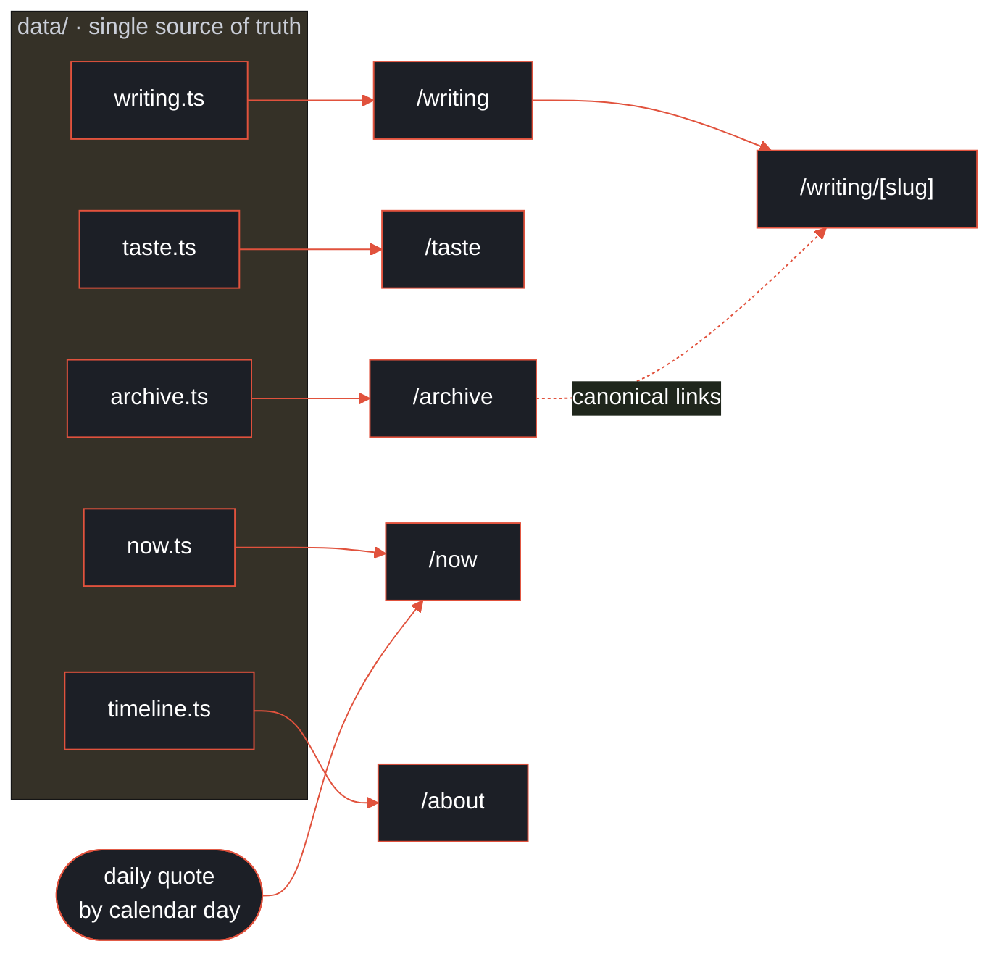

<div align="center">


### 📖 *More than just a tech portfolio, it’s a memoir of my journey..*

<a href="https://garudvedantportfolio.vercel.app">
  
</a>

<br/>

[](https://nextjs.org/)
[](https://react.dev/)
[](https://www.typescriptlang.org/)
[](https://tailwindcss.com/)
[](https://www.framer.com/motion/)
[](https://garudvedantportfolio.vercel.app)
[](https://github.com/vedantgrd/myPortfolio/commits/main)

<br/>

**VEDANT / UNFINISHED** is a personal digital publication, a living archive, and a technical laboratory. Not a résumé with a coat of paint: a place you walk into.

[Philosophy](#-the-core-philosophy) &nbsp;•&nbsp; [Features](#-key-features) &nbsp;•&nbsp; [Visual Tour](#-visual-tour) &nbsp;•&nbsp; [Work](#-featured-projects) &nbsp;•&nbsp; [Architecture](#️-architecture--tech-stack) &nbsp;•&nbsp; [Getting Started](#-getting-started) &nbsp;•&nbsp; [Sitemap](#️-the-sitemap) &nbsp;•&nbsp; [Contact](#-contact)

<br/>

<table>
<tr><td>🔴 🟡 🟢 &nbsp;&nbsp;<code>garudvedantportfolio.vercel.app</code></td></tr>
<tr><td>
<a href="https://garudvedantportfolio.vercel.app"></a>
</td></tr>
</table>

</div>

<br/>

---

## 🎯 The Core Philosophy

Traditional portfolios say: *"Here are my skills, here are my projects, here is my résumé."* They are efficient, and they are forgettable. They tell you what someone can do and almost nothing about who they are.

1. **A life, in progress**: Software engineering and personal humanity belong to the same person. Neither is a side quest.
2. **One canonical home per piece**: Every essay lives in *Notebook*, every project in *Work*, culture in *Taste*, verified milestones in *Archive*, the current chapter in *Now*. Other pages preview or reference the source; they never duplicate it.
3. **Personal, not corporate**: A real face. Candid writing on mental health (*So, Suicide.*), social responsibility (*Orphanage community visit*), cinema idols, and engineering failures (*Agridrone motor harmonics*).
4. **Editorial, not monotonous**: High-contrast **Geist & Geist Mono** typography, warm deep ink surfaces (`#0d0f12`), a restrained vermilion accent (`#e1523d`), and tactile layout grids.
5. **Deterministic, not arbitrary**: The daily quote rotates by calendar day, not at random. Every listed skill links to real implementation evidence.

> **The Promise:**
> *"A life, in progress. Software and humanity, in the same place, with receipts."*

<div align="center">


</div>

---

## ✨ Key Features

### 📚 For Readers

- **The Notebook**: A single destination for all writing: personal essays (*So, Suicide.*, *A Tuesday at the Orphanage*), cinema & culture (*Why We Need Heroes*), superheroes, and engineering postmortems. Each piece has a long-form reading view with formatted code snippets, quote callouts, and previous/next navigation.
- **Case-Study Work Exhibition**: A filterable catalog (AI & Systems, Hardware & IoT, Security & Systems, Interactive & Games, Web Platforms). Every case study shows the architecture, the problem, key decisions, **what broke and how it was fixed**, verified outcomes, and the real tech stack.
- **Taste & Influences**: A cultural archive featuring the 4 formative films, 4 songwriters, and 4 books that shaped the author's worldview.
- **The Living Laboratory**: Interactive instruments you can actually use: the Bullwhip AI Simulator (with real-time demand oscillation chart & safety stock dampener), the CipherLab Cryptography Workbench (Caesar, Vigenère, and Avalanche bit-flip tester), and a Project-Linked Skill Evidence Matrix.
- **Strictly Factual Archive**: A 2022–2026 chronology of education, internships, hackathons, and milestones, each linking back to its canonical source.
- **Right Now**: A public snapshot of what is being built, learned, consumed, and thought about, with a **deterministic daily quotation**.
- **Direct Transmission & Private Inbox**: Direct message transmission with instant feedback, verified social links, prefilled email dispatch, and a passkey-protected `/admin` inbox subsystem for private message review.

### ✍️ For the Author

- **No CMS, one-file publishing**: Add an article, a film, a milestone, or a "now" update by editing a single typed data file. The site updates itself.
- **Auto-generated routes**: Every article gets its own shareable `/writing/[slug]` route and is indexed automatically.
- **Canonical linking**: The Archive links to `/work/[slug]` and `/writing/[slug]`, so facts live in exactly one place.
- **Permanent redirects**: `/cinema` → `/taste` and `/ordinary-days` → `/archive`, so old links never break.
- **Type safety end to end**: TypeScript 5.7 across routes, data, and components.

---

## 📸 Visual Tour

### 1. Cover Trailer · `/`
*An editorial trailer with selected works, a notebook preview, taste highlights, the daily quote, and clear paths deeper.*

<table>
<tr><td>🔴 🟡 🟢 &nbsp;&nbsp;<code>/</code></td></tr>
<tr><td><a href="https://garudvedantportfolio.vercel.app"></a></td></tr>
</table>

---

### 2. Work Exhibition · `/work`
*A filterable project catalog across five categories. Each project opens a full case study.*

<table>
<tr><td>🔴 🟡 🟢 &nbsp;&nbsp;<code>/work</code></td></tr>
<tr><td><a href="https://garudvedantportfolio.vercel.app/work"></a></td></tr>
</table>

---

### 3. The Notebook · `/writing`
*Essays, cinema & culture, and engineering postmortems, all in one canonical home.*

<table>
<tr><td>🔴 🟡 🟢 &nbsp;&nbsp;<code>/writing</code></td></tr>
<tr><td><a href="https://garudvedantportfolio.vercel.app/writing"></a></td></tr>
</table>

---

### 4. Taste & Influences · `/taste`
*Four formative films, four songwriters, and the four books that stuck.*

<table>
<tr><td>🔴 🟡 🟢 &nbsp;&nbsp;<code>/taste</code></td></tr>
<tr><td><a href="https://garudvedantportfolio.vercel.app/taste"></a></td></tr>
</table>

---

### 5. Personal Narrative · `/about`
*Why engineering, working principles, values, verified academic path, and curriculum vitae.*

<table>
<tr><td>🔴 🟡 🟢 &nbsp;&nbsp;<code>/about</code></td></tr>
<tr><td><a href="https://garudvedantportfolio.vercel.app/about"></a></td></tr>
</table>

---

### 6. The Archive · `/archive`
*A strictly factual 2022–2026 chronology, linked to canonical sources.*

<table>
<tr><td>🔴 🟡 🟢 &nbsp;&nbsp;<code>/archive</code></td></tr>
<tr><td><a href="https://garudvedantportfolio.vercel.app/archive"></a></td></tr>
</table>

---

### 7. Right Now · `/now`
*A living snapshot of what is being built, learned, and consumed, plus the daily quote.*

<table>
<tr><td>🔴 🟡 🟢 &nbsp;&nbsp;<code>/now</code></td></tr>
<tr><td><a href="https://garudvedantportfolio.vercel.app/now"></a></td></tr>
</table>

---

### 8. The Living Laboratory · `/lab`
*Bullwhip AI Simulator, CipherLab Workbench, and the Skill Evidence Matrix.*

<table>
<tr><td>🔴 🟡 🟢 &nbsp;&nbsp;<code>/lab</code></td></tr>
<tr><td><a href="https://garudvedantportfolio.vercel.app/lab"></a></td></tr>
</table>

---

### 9. Direct Transmission · `/contact`
*One-click email copy, verified social links, and a transmission line.*

<table>
<tr><td>🔴 🟡 🟢 &nbsp;&nbsp;<code>/contact</code></td></tr>
<tr><td><a href="https://garudvedantportfolio.vercel.app/contact"></a></td></tr>
</table>

---

## 🔬 Featured Projects

<table>
<tr>
<td width="50%" valign="top">

#### ⚡ Vidyut
*AI-first student success platform*

An **Education DNA** multi-dimensional student profile, a deterministic hard-filter pass (**under 45 ms**), and a verified application state machine.

`Next.js 16` `TypeScript` `FastAPI` `PostgreSQL` `Tailwind CSS`

</td>
<td width="50%" valign="top">

#### 📦 Bullwhip AI
*Supply-chain multi-agent system*

A 4-echelon agent network (Retailer → Wholesaler → Distributor → Factory) that dampens perishable-food demand oscillation by **about 34%** using coordinated exponential smoothing.

`Python` `Discrete-event modeling` `Recharts` `TypeScript`

</td>
</tr>
<tr>
<td width="50%" valign="top">

#### 🚁 Agridrone
*Hardware & telemetry*

A custom quadcopter with flight-controller avionics, GPS hold, a **433 MHz serial radio bridge**, and a native Android ground station for crop inspection.

`Android (Java)` `Python` `MAVLink / Serial` `Microcontrollers`

</td>
<td width="50%" valign="top">

#### 🔐 CipherLab
*Applied cryptography & forensics*

A visual cryptanalysis suite: classical ciphers, frequency analysis against English distributions, and bit-level **Avalanche Effect** diffusion testing.

`TypeScript` `Recharts` `SVG`

</td>
</tr>
<tr>
<td width="50%" valign="top">

#### 🎮 Pokémon RPG
*2D game physics & state machines*

A Pygame **delta-time** loop, **AABB** tile collision with slide vectoring, and isolated turn-based battle state machines.

`Python 3` `Pygame` `Tiled`

</td>
<td width="50%" valign="top">

#### 🏁 DevSprint
*Hackathon aggregator & management portal*

A 3-tier platform with a normalized **MySQL** schema, event filtering, countdown timers, and an admin review pipeline.

`PHP` `MySQL` `JavaScript` `Three.js` `Figma`

</td>
</tr>
</table>

---

## 🏗️ Architecture & Tech Stack

A **Next.js App Router** site where all content lives in typed data files.

```
myPortfolio/
├── app/                  # App Router: every canonical route in the sitemap
├── components/           # UI components, simulators, visual frames, navigation
├── data/                 # writing.ts · taste.ts · archive.ts · now.ts · timeline.ts
├── hooks/                # Custom React hooks
├── lib/                  # Shared utilities
├── public/               # Static assets & resume.pdf
├── styles/               # Global styles and design tokens
├── next.config.mjs       # Next.js config and permanent redirects
├── postcss.config.mjs    # Tailwind CSS 4 via @tailwindcss/postcss
├── tsconfig.json
├── pnpm-lock.yaml
└── package.json
```

### How content flows



### Technology highlights

| Layer | Technologies |
|---|---|
| **Framework** | Next.js 16 (App Router with Turbopack) |
| **UI & logic** | React 19, TypeScript 5.7 |
| **Styling** | Tailwind CSS 4 with `@tailwindcss/postcss`, shadcn/ui configured |
| **Motion** | Framer Motion 12 |
| **Data viz** | Recharts 2.15 and custom SVG |
| **Icons** | Lucide React |
| **Typography** | Geist & Geist Mono via `next/font/google` |
| **Package manager** | pnpm (npm also works) |
| **Deployment** | Vercel |

---

## 🚀 Getting Started

**Prerequisites:** Node.js 20+ (required by Next.js 16) and [pnpm](https://pnpm.io/) or [npm](https://nodejs.org/).

### Step 1: Clone the repository

```bash
git clone https://github.com/vedantgrd/myPortfolio.git
cd myPortfolio
```

### Step 2: Install dependencies

```bash
pnpm install
# or
npm install
```

### Step 3: Start the dev server

```bash
pnpm dev
# or
npm run dev
```

Open [`http://localhost:3000`](http://localhost:3000).

### Step 4: Build for production

```bash
npm run build
npm run start
```

---

## 🗺️ The Sitemap

| Route | Chapter | Canonical content |
|---|---|---|
| `/` | **01 // Cover Trailer** | Selected works, notebook preview, taste highlights, daily quote, hero portrait |
| `/work` | **02 // Work Exhibition** | Filterable project catalog across 5 domains |
| `/work/[slug]` | **Case Studies** | Architecture, decisions, what broke, verified outcomes |
| `/writing` | **03 // The Notebook** | All published writing, personal memoir pieces, engineering postmortems |
| `/writing/[slug]` | **Reading View** | Long-form reading, code snippets, callout boxes, prev/next pagination |
| `/taste` | **04 // Taste & Influences** | Cultural archive: 4 films, 4 songwriters, 4 formative books |
| `/about` | **05 // Personal Narrative** | Why engineering, working principles, education timeline, verified résumé (`/resume.pdf`) |
| `/archive` | **06 // The Archive** | Factual chronology 2022–2026, linking to canonical sources |
| `/now` | **07 // Right Now** | Building, learning, consuming, and the deterministic daily quote |
| `/lab` | **08 // The Living Laboratory** | Bullwhip AI Simulator, CipherLab Cryptography Workbench, Skill Evidence Matrix |
| `/contact` | **09 // Direct Transmission** | Email copy, verified social links (GitHub, LinkedIn, X), transmission form |
| `/admin` | **10 // Transmission Terminal** | Passkey-protected private inbox subsystem for incoming messages |

<sub>`/cinema` permanently redirects to `/taste`; `/ordinary-days` redirects to `/archive`.</sub>

### 🎞️ What's in Taste

| 🎬 Films (Top 4) | 🎵 Songwriters (Top 4) | 📚 Books (Top 4) |
|---|---|---|
| *Taxi Driver* (Martin Scorsese, 1976) | The Beatles | *Steve Jobs*, Walter Isaacson |
| *Manchester by the Sea* (Kenneth Lonergan, 2016) | The Smiths | *Atomic Habits*, James Clear |
| *Shutter Island* (Martin Scorsese, 2010) | One Direction | *The Design of Everyday Things*, Don Norman |
| *The Hangover* (Todd Phillips, 2009) | Michael Jackson | *Deep Work*, Cal Newport |

---

## ✍️ Publishing Guide

| To do this | Open | Then |
|---|---|---|
| 📝 Publish an article | `data/writing.ts` | Add an entry to the `articles` array. It appears in `/writing`, gets its own `/writing/[slug]`, and is indexed automatically. |
| 🎬 Update Taste | `data/taste.ts` | Append a film, artist, or book. |
| 🗓️ Add a milestone | `data/archive.ts` | Append a dated, factual entry with a canonical link to `/work/[slug]` or `/writing/[slug]`. |
| 📍 Update the present | `data/now.ts` | Edit `building`, `learning`, or `consuming`. |
| 🎓 Update Academic & Journey | `data/timeline.ts` | Add an entry with dates, summary, and verification details. |

---

## 📬 Contact

<table align="center">
  <tr>
    <td align="center">
      <strong>Vedant Garud</strong><br>
      B.Tech, Information Technology<br>
      (Information Security &amp; Data Forensics)<br>
      Pillai College of Engineering, New Panvel<br>
      Backend Developer Intern, VFS Global, Mumbai<br>
      <sub>Jul 2024</sub>
    </td>
  </tr>
</table>

<div align="center">

[](mailto:vedantgarud05@gmail.com)
[](https://github.com/vedantgrd)
[](https://garudvedantportfolio.vercel.app)

<br/>


<sub>© Vedant Garud</sub>

</div>
